# zmk-config-roBa（自分用カスタマイズ版）

自作キーボード [roBa](https://github.com/kumamuk-git/zmk-config-roBa)（トラックボールとロータリーエンコーダの付いた分割キーボード）を組み立て、ZMK の設定を自分の使い方に合わせて書き換えたリポジトリです。元の設定は kumamuk-git さんのリポジトリをフォークしています。

- **部品の調達**：販売されているキットが手に入らなかったため、公開されている設計データを GitHub から集め、基板とケース（3D プリント）を外部に発注した。トラックボール用センサー（PMW3610）などの部品も個別に探して揃えた
- **組み立て**：基板へのはんだ付けから組み立てまで自分で行った
- **接続**：Bluetooth（BLE）で無線接続（左右の間も無線）
- **ビルド**：GitHub Actions でファームウェアをビルドし、Seeed XIAO BLE に書き込んでいる

## つまずいたこと

- **基板の発注ミス**：抵抗などの極小部品は、基板メーカーにあらかじめ実装してもらう（実装サービス）前提の設計だったが、それに気づかず基板だけを発注してしまった。届いてから手作業でははんだ付けできないと分かり、実装ありで注文し直した。それ以降は、発注前に部品表（BOM）でどの部品が実装サービス前提かを確認してから注文している。

## 元の設定から変えたところ

| 対象 | 元の設定 | 変更後 | ファイル |
|---|---|---|---|
| ロータリーエンコーダ（通常レイヤー） | PageUp / PageDown | マウスホイールのスクロール。`zmk,behavior-sensor-rotate` で独自の behavior（`encoder_msc_down_up`）を定義 | `config/roBa.keymap` |
| エンコーダの感度 | `steps = <12>` | `steps = <24>` | `boards/shields/roBa/roBa.dtsi` |
| スクロール量 | 既定値 | `ZMK_POINTING_DEFAULT_SCRL_VAL 80` | `config/roBa.keymap` |
| 親指キー | 左＝変換、右＝無変換 | 左＝無変換、右＝変換（入れ替え） | `config/roBa.keymap` |
| 矢印レイヤー | 右手側は未割り当て | 右手側にテンキー（0〜9・Tab・Backspace）を配置 | `config/roBa.keymap` |
| 記号レイヤー | 空きキー | `?` を割り当て | `config/roBa.keymap` |

